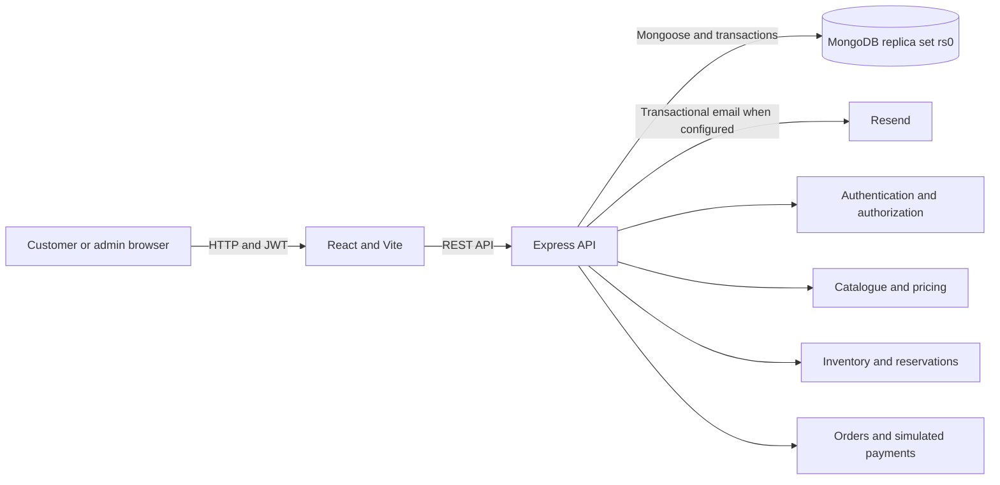

# PizzaHop

**A full-stack pizza ordering application with a customizable menu, transactional stock reservations, and order fulfillment tracking.**

## Table of contents

- [Overview](#overview)
- [Key features](#key-features)
- [Technology stack](#technology-stack)
- [Architecture](#architecture)
- [Screenshots](#screenshots)
- [Local setup](#local-setup)
- [Docker development setup](#docker-development-setup)
- [Environment configuration](#environment-configuration)
- [Testing](#testing)
- [Payment disclaimer](#payment-disclaimer)
- [Future improvements](#future-improvements)

## Overview

PizzaHop is a full-stack application for building and ordering pizzas while keeping catalogue pricing, inventory availability, and order progress in one workflow. Customers can choose a menu pizza, customize its ingredients, check out, and follow fulfillment status. Administrators can manage ingredient stock and progress paid orders.

The project demonstrates server-side price calculation, role-based authentication, MongoDB transactions for inventory reservations and payment outcomes, and separate customer and administrative workflows.

## Key features

- **Customer authentication and email verification:** registration, verified-account login, JWT access tokens, rotating refresh sessions, password reset, and Resend email integration.
- **Pizza catalogue and custom pizza builder:** predefined pizzas with backend-priced bases, sauces, cheese, and vegetable choices.
- **Cart and checkout:** customer-specific carts; checkout recalculates prices from MongoDB and records immutable order price snapshots.
- **Order history and tracking:** customers can view their orders and follow a status timeline that refreshes while an order is in progress.
- **Admin inventory management:** role-protected inventory views, stock adjustments, and audit movements.
- **Stock reservation and availability management:** checkout reserves ingredient quantities transactionally; successful simulated payment consumes reserved stock, while failure or expiry releases it. Available stock accounts for reservations.
- **Admin order management:** inspect customer orders, filter by fulfillment status, and advance paid orders through `PLACED`, `CONFIRMED`, `PREPARING`, `OUT_FOR_DELIVERY`, and `DELIVERED`. Status history records the actor and time.
- **Low-stock email alerts:** configurable thresholds, duplicate suppression until stock recovers, scheduled checks, and Resend delivery when configured.

## Technology stack

- **Frontend:** React 19, Vite 6, JavaScript, CSS
- **Backend:** Node.js, Express 4, ES modules
- **Database:** MongoDB, Mongoose 8; transactions require a replica set
- **Authentication and validation:** JSON Web Tokens, bcryptjs, Zod, express-rate-limit
- **Security and integration:** Helmet, CORS, Resend
- **Development environment:** Docker, Docker Compose, npm workspaces

## Architecture

The browser UI calls the Express API. The API authenticates and validates requests, applies business rules in services, and uses Mongoose for persistence. MongoDB stores users, catalogue and inventory data, carts, orders, payment attempts, and audit state. Resend is used for email when configured.



## Screenshots

No screenshots are included yet. These are suggested paths for adding real screenshots; the files are placeholders and should be added after capturing the running application:

- `screenshots/customer-catalogue.png`
- `screenshots/custom-pizza-builder.png`
- `screenshots/customer-order-tracking.png`
- `screenshots/admin-inventory.png`
- `screenshots/admin-orders.png`

## Local setup

### Prerequisites

- Node.js 20 or newer (includes npm)
- MongoDB 6 or newer, configured as a single-node replica set named `rs0`

MongoDB transactions are used for order creation and inventory/payment changes. A standalone MongoDB server is not sufficient.

### Install and run

1. Start MongoDB with replica set `rs0`. For a local `mongod`, enable `--replSet rs0` and initialize the replica set once with `rs.initiate()` in `mongosh`.
2. Copy the environment template and configure it:

   ```powershell
   Copy-Item server/.env.example server/.env
   ```

   Replace the JWT secrets, token hash pepper, and admin seed password as described in [Environment configuration](#environment-configuration). Do not commit `.env` files.

3. Install dependencies from the repository root:

   ```powershell
   npm install
   ```

4. Start the API and Vite development server:

   ```powershell
   npm run dev
   ```

5. Open <http://localhost:5173>. The API health endpoint is <http://localhost:3000/api/v1/health>.

The API waits for MongoDB and exits if required configuration or the database is unavailable. The health endpoint returns HTTP 503 while the database is disconnected.

### Seed local data

With MongoDB running and configured, seed the initial catalogue and admin account:

```powershell
npm run seed:catalogue --workspace=@pizzahop/server
npm run seed:admin --workspace=@pizzahop/server
```

The catalogue and admin seed scripts are idempotent. Admin credentials come from `ADMIN_SEED_EMAIL` and `ADMIN_SEED_PASSWORD`; there is no public admin registration route. Customer registration is available at `/register`; verify the account using the email link before signing in.

Other useful commands:

```powershell
npm run dev:server
npm run dev:client
npm run build
npm start
```

The frontend runs on port 5173 and the API on port 3000 by default.

## Docker development setup

Docker Compose runs the Vite development server, Express API, and MongoDB 7 on a private Compose network. MongoDB is configured as a single-node replica set named `rs0`. A one-shot initializer waits for the member to become primary; the API starts after initialization succeeds and becomes healthy only when its database-backed health endpoint responds. MongoDB data persists in the named `mongo_data` volume. The frontend and API source directories are mounted for development.

In PowerShell from the repository root, create the Docker-specific environment file:

```powershell
Copy-Item .env.docker.example .env.docker
```

Edit `.env.docker`: set three independent random values for `JWT_ACCESS_SECRET`, `JWT_REFRESH_SECRET`, and `TOKEN_HASH_PEPPER`, and set a strong `ADMIN_SEED_PASSWORD`. Generate each secret with:

```powershell
node -e "console.log(require('crypto').randomBytes(48).toString('hex'))"
```

Keep `.env.docker` local. It is not copied into the images. This setup does not read `server/.env`. `RESEND_API_KEY` may be left blank for local testing; email delivery will then be unavailable.

Build and start the services:

```powershell
docker compose up --build
```

Open <http://localhost:5173>. Verify API and database status at <http://localhost:3000/api/v1/health>. Confirm the replica-set primary with:

```powershell
docker compose exec mongo mongosh --quiet --eval "rs.status().set + ' / ' + rs.status().members[0].stateStr"
```

Expected output: `rs0 / PRIMARY`. Seed the Docker database with:

```powershell
docker compose exec api npm run seed:catalogue --workspace=@pizzahop/server
docker compose exec api npm run seed:admin --workspace=@pizzahop/server
```

Stop with `Ctrl+C` or run `docker compose down`. The named database volume remains for the next start. To also remove the local database, run `docker compose down --volumes`. The Docker frontend is a Vite development server, not a production static server. The mock payment provider is for development only and must not be enabled in production.

## Environment configuration

Use `server/.env.example` for local API settings and `.env.docker.example` for Compose. The client template is `client/.env.example`. These are templates, not production credentials. Keep actual `.env` files out of version control and never place server secrets in a `VITE_` variable.

| Variable | Purpose |
| --- | --- |
| `MONGODB_URI` | MongoDB connection string. Use `replicaSet=rs0`; Compose uses the internal `mongo` service name. |
| `CORS_ORIGIN`, `FRONTEND_ORIGIN` | Allowed browser origin and frontend URL used by email links. Must be HTTP(S) origins without paths. |
| `JWT_ACCESS_SECRET`, `JWT_REFRESH_SECRET`, `TOKEN_HASH_PEPPER` | Three distinct random secrets, each at least 32 bytes. Required by the API. |
| `JWT_ACCESS_TTL`, `JWT_REFRESH_TTL` | Access and refresh lifetimes; examples use `15m` and `7d`. |
| `AUTH_COOKIE_SAME_SITE`, `TRUST_PROXY_HOPS` | Refresh-cookie and reverse-proxy settings. `none` requires production HTTPS. |
| `RESEND_API_KEY`, `EMAIL_FROM` | Resend email delivery and sender. Without an API key, email features cannot deliver messages. |
| `EMAIL_VERIFICATION_TTL`, `EMAIL_VERIFICATION_RESEND_COOLDOWN`, `PASSWORD_RESET_TTL` | Verification and password reset token timing. |
| `ADMIN_SEED_EMAIL`, `ADMIN_SEED_PASSWORD` | Credentials used only by the admin seed script. Never expose them in a public client. |
| `INVENTORY_LOW_STOCK_THRESHOLD`, `INVENTORY_ALERT_CHECK_INTERVAL_MS`, `INVENTORY_ALERT_EMAIL` | Low-stock alert threshold, scan interval, and recipient. |
| `MOCK_PAYMENTS_ENABLED` | Enables the simulated payment provider in development. The server rejects enabling it in production. |
| `PORT` | API listening port; defaults to 3000. |
| `VITE_API_BASE_URL` | Optional client API URL; defaults to `http://localhost:3000/api/v1`. |

Authentication rate limits and email timing defaults are also documented in `server/.env.example`. Never publish real secret values.

## Testing

Run the existing backend test suite from the repository root:

```powershell
npm test --workspace @pizzahop/server
```

The suite covers authentication and email verification, catalogue pricing and carts, inventory adjustments and alerts, reservations, order/payment flows, and admin order tracking/status transitions. Tests use the configured MongoDB replica set; email delivery is mocked in tests. The project currently has no separate frontend unit-test script.

Build the frontend for production with:

```powershell
npm run build
```

## Payment disclaimer

PizzaHop currently uses a **simulated/mock payment provider for development demonstrations**. It does not process payments or transfer real money. **Razorpay is not integrated.** The payment provider boundary is separated from order and inventory services to allow a future gateway adapter.

## Future improvements

- Integrate a real payment gateway with provider-side signature verification, webhook handling, and reconciliation.
- Add a production deployment configuration with HTTPS, managed MongoDB replica-set infrastructure, secret management, and operational monitoring.
- Add durable retry/outbox handling for transactional email notifications.
- Add order cancellation and refund workflows with safe reservation release and payment coordination.
- Add pagination and search to the admin order list, plus automated frontend tests.
